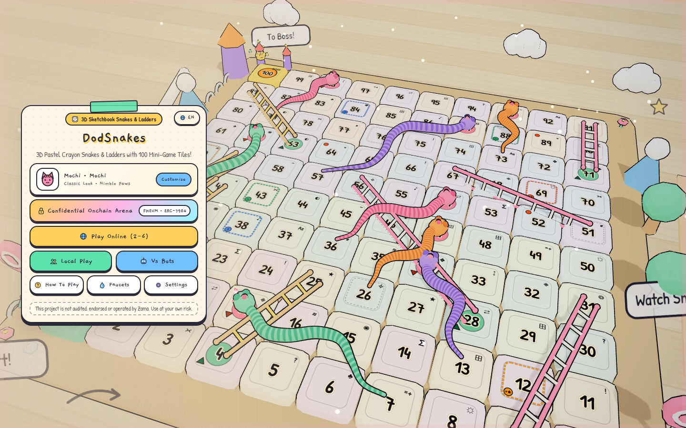
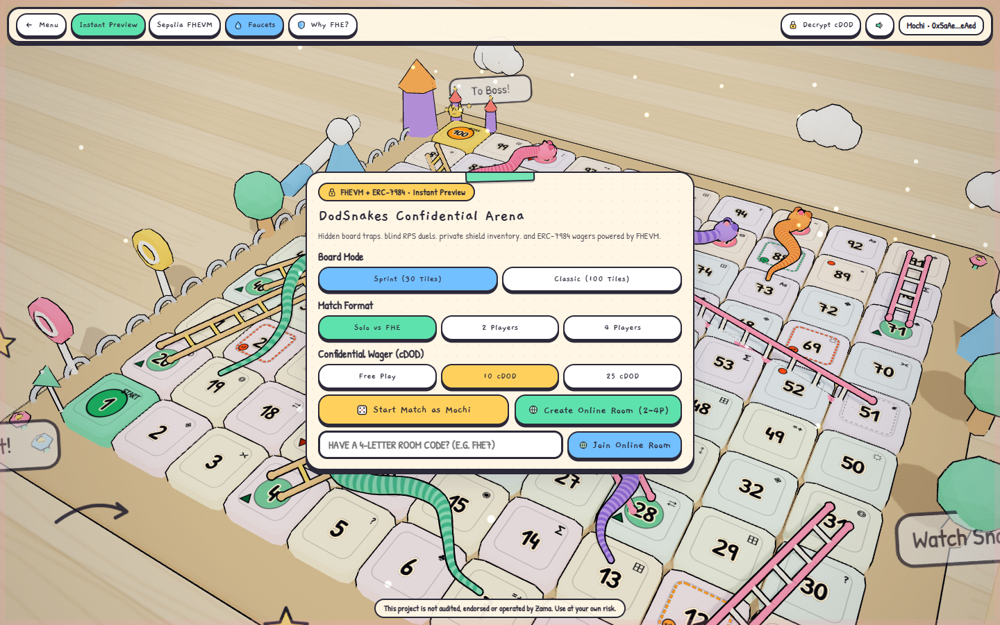
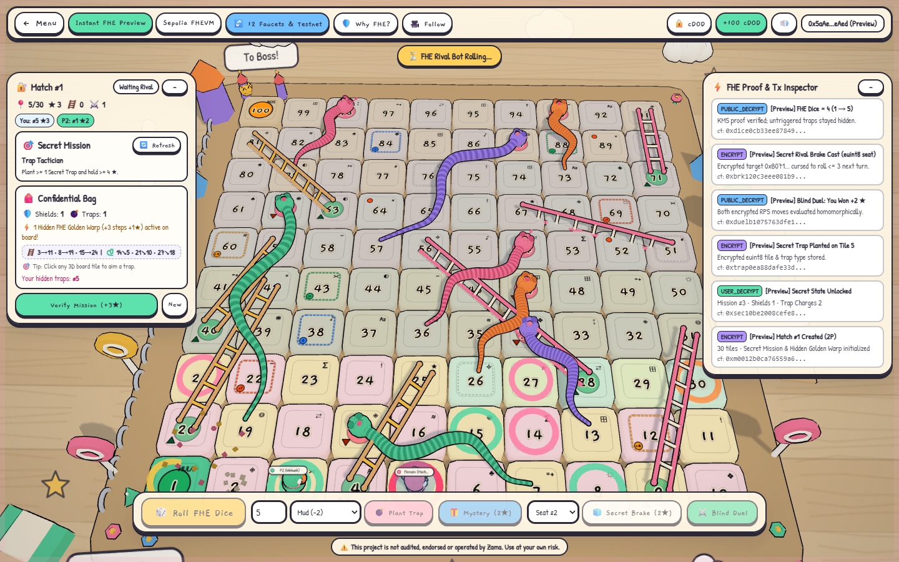
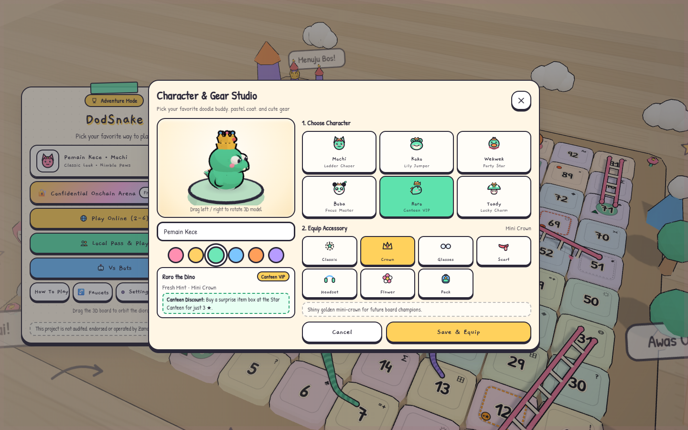
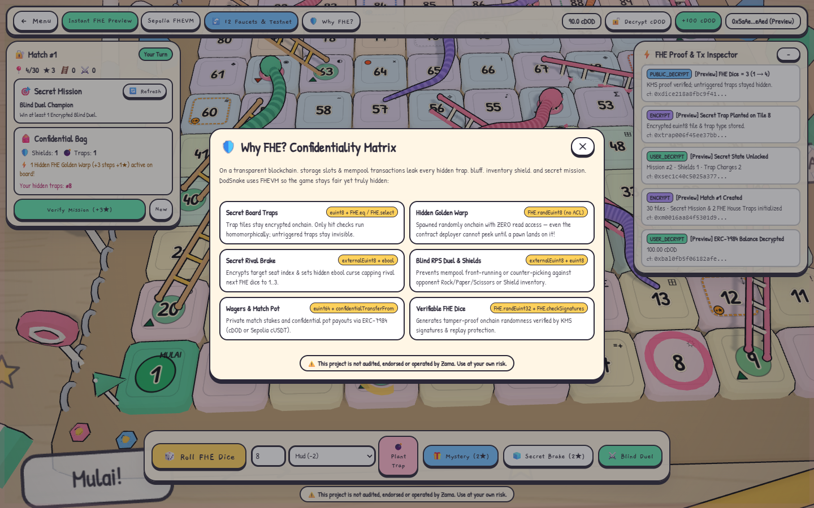
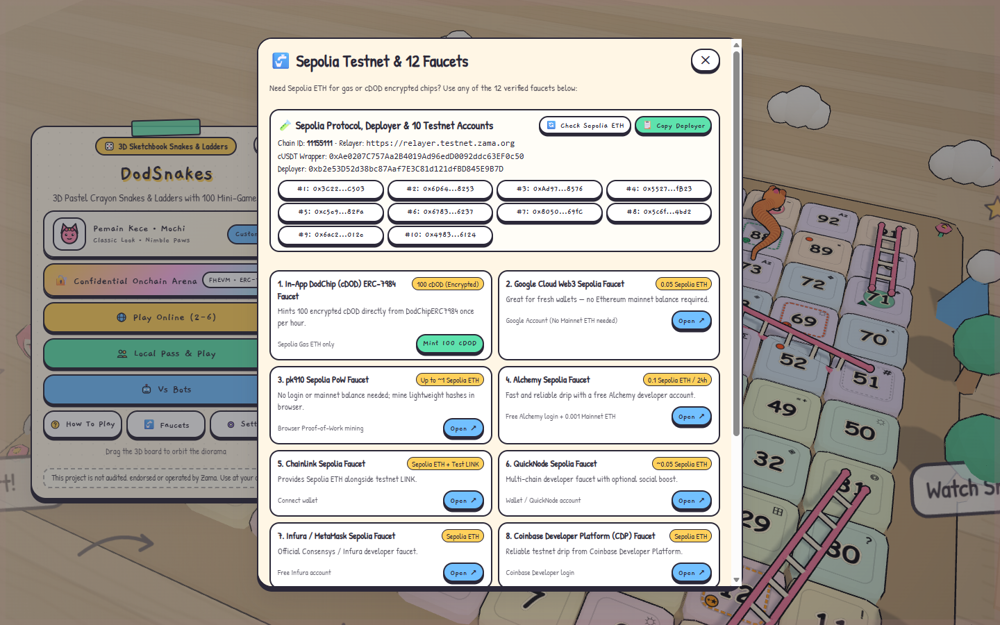
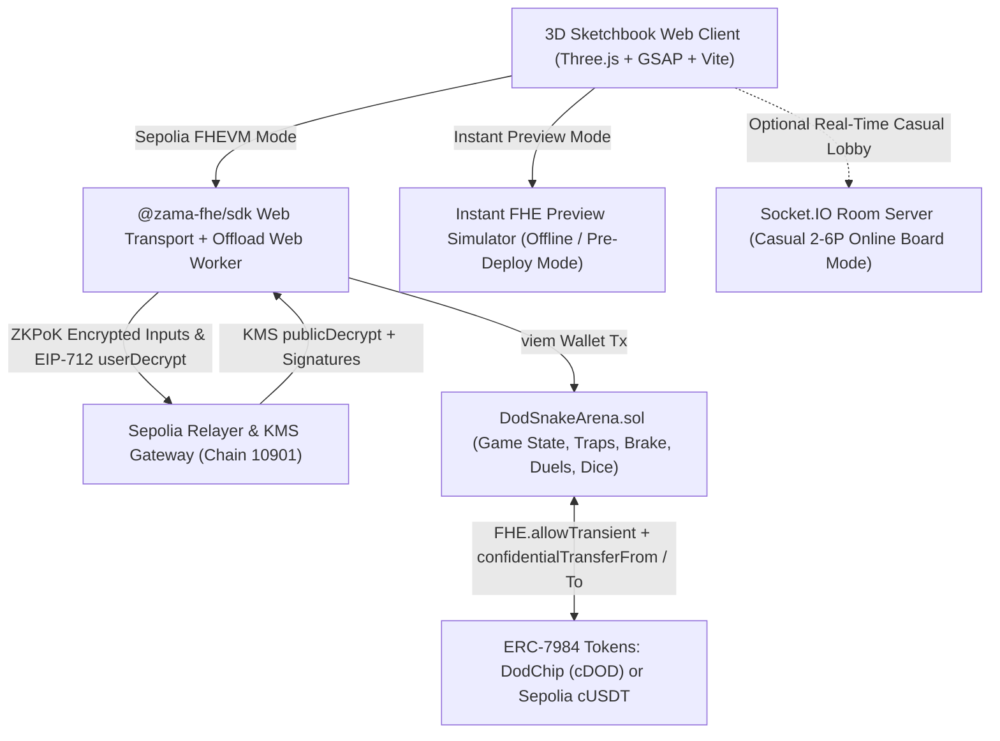
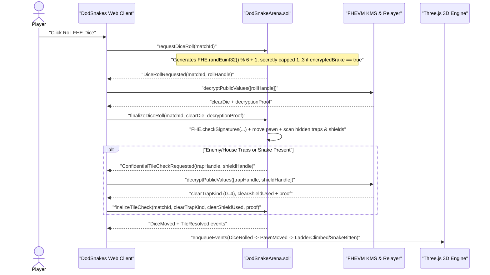

# DodSnakes

> **Disclaimer:** This project is not audited, endorsed or operated by Zama. Use at your own risk.

**DodSnakes** is a semi-doodle 3D multiplayer tabletop Snakes & Ladders board game set on a sketchbook wooden desk, powered by a **Confidential Onchain Arena** built with Fully Homomorphic Encryption (**FHEVM**) and **ERC-7984** confidential tokens on Ethereum Sepolia.

Players roll verifiable onchain FHE dice, hide secret board traps, cast encrypted rival curses, discover zero-ACL Golden Warp shortcuts, protect themselves with hidden Anti-Snake Shields, compete in blind encrypted 1v1 Rock-Paper-Scissors duels, verify secret match objectives, and wager encrypted `ERC-7984` pots (`cDOD` or Sepolia `cUSDT`) alongside 3D character customization, 24 interactive mini-games across tiles `2-99`, Online Multiplayer, Local Hot-Seat Mode, and Smart Bots.

---

## Visual Game Showcase

### 3D Sketchbook Diorama & Main Menu


### Confidential Onchain Arena — Lobby & Live Match Gameplay

| Confidential Arena Setup (`cDOD` & `cUSDT` ERC-7984 Flow) | Live FHE Match HUD, 3D Trap Aura & Proof Inspector |
| :---: | :---: |
|  |  |

| 3D Character & Gear Studio | In-App Privacy Matrix | 12 Faucets & 10 Testnet Accounts |
| :---: | :---: | :---: |
|  |  |  |

---

## Why This Game Requires FHE (Impossible on a Public Chain)

On a transparent EVM chain, `eth_getStorageAt` and mempool inspection break strategy before a turn resolves. `DodSnakes` uses encrypted FHEVM types (`euint8`, `euint32`, `euint64`, `ebool`) and OpenZeppelin `ERC-7984` so competitive secrets remain ciphertext onchain while still enforcing deterministic game rules:

| Confidential Mechanic | Onchain Ciphertext & Primitives | Who Can Read Plaintext? | Why Transparent Blockchains Break |
| --- | --- | --- | --- |
| **Secret Board Traps** | `euint8` tile & kind + `FHE.eq` / `FHE.select` | Trap planter only (`FHE.allow`) | Rivals would read trap storage slots and avoid every planted square |
| **Hidden Golden Warp Shortcut** | `FHE.randEuint8` spawned in `_activateMatch` | **Nobody** until stepped on (`kind = 4`) | Even the match creator/deployer could peek and rush the `+3 steps +1 ★` boost |
| **Secret Rival Brake Curse** | `castSecretBrake` (`externalEuint8` seat + `ebool`) | **Nobody** (applied inside `requestDiceRoll`) | Publicly revealing who was cursed lets rivals burn items or alter timing |
| **Confidential Shields & Trap Charges** | `euint8` bag counters (`buyEncryptedMysteryItem`) | Owner only via EIP-712 `userDecrypt` | Opponents would know whether a snake bite or ambush is blocked beforehand |
| **Blind 1v1 RPS Duels** | `externalEuint8` moves + FHE boolean truth table | Only outcome (`0=Tie, 1=Win, 2=Lose`) revealed | Mempool listeners would front-run second submissions to guarantee wins |
| **Secret Match Missions** | `FHE.randEuint8(4)` objective per player | Owner only; homomorphic claim verification | Reveals tactical win conditions to opponents early |
| **ERC-7984 Wagers & Pots** | `euint64` pot (`DodChipERC7984` / Sepolia `cUSDT`) | Encrypted balance owner via ACL | Wallet spying exposes bankroll size and exact wager amounts |

---

## System Architecture & FHE Protocol Flows

### High-Level Architecture



### Verifiable FHE Dice, Rival Brake & Homomorphic Trap Flow



### Blind Encrypted Duel & Confidential ERC-7984 Settlement

```mermaid
sequenceDiagram
    actor Challenger
    actor Opponent as "Opponent / FHE House Bot"
    participant Arena as "DodSnakeArena.sol"
    participant Token as "ERC-7984 Token (cDOD / cUSDT)"

    Challenger->>Token: "setOperator(arenaAddress, expiry)"
    Challenger->>Arena: "createMatch(mode, stakeToken, encWager, inputProof)"
    Arena->>Token: "FHE.allowTransient + confidentialTransferFrom(player -> arena)"
    Challenger->>Arena: "startBlindDuel(matchId, opponent)"
    Challenger->>Arena: "submitBlindDuelMove(matchId, encRockPaperScissors, proof)"
    Opponent->>Arena: "submitBlindDuelMove(...) or FHE.randEuint8(4)%3"
    Arena->>Arena: "Homomorphically evaluate winner; reveal outcome only via KMS"
    Challenger->>Arena: "finalizeBlindDuel(matchId, outcome, decryptionProof)"
    Challenger->>Arena: "claimMatchPayout(matchId)"
    Arena->>Token: "confidentialTransfer(winner, encryptedPot)"
```

---

## Monorepo Layout

- [`packages/contracts`](packages/contracts) (`@doodle-dash/contracts`): Hardhat workspace with `@fhevm/solidity` (`0.11.1`) and `@openzeppelin/confidential-contracts` (`0.5.3`).
  - [`DodChipERC7984.sol`](packages/contracts/contracts/DodChipERC7984.sol): ERC-7984 confidential chip token (`DodChip` / `cDOD`, 6 decimals) with `claimFaucet()` (`100 cDOD`, 1-hour cooldown) and batch testnet minting.
  - [`DodSnakeArena.sol`](packages/contracts/contracts/DodSnakeArena.sol): Full FHEVM game contract supporting Sprint `30`-tile and Classic `100`-tile modes, hidden House/Player Traps, random zero-ACL Golden Warp, `castSecretBrake`, Encrypted Mystery Bag, Verifiable FHE Dice, Blind 1v1 RPS Duels, Secret Match Missions, and ERC-7984 pot escrow.
  - [`DodSnakeConfidential.test.ts`](packages/contracts/test/DodSnakeConfidential.test.ts): **18 automated FHEVM + ERC-7984 tests** including ACL leak rejection, forged/replayed proof rejection, encrypted trap charge exhaustion (`FHE.select`), Secret Brake, Golden Warp, early lobby kickoff, Blind Duel progress getters, and 10-account multi-room play.
- [`packages/shared`](packages/shared) (`@doodle-dash/shared`): Pure deterministic game engine, seeded PRNG, tile generator, Zod multiplayer schemas, 1,000-match bot simulator, and Vitest suite.
- [`apps/server`](apps/server) (`@doodle-dash/server`): Authoritative Express + Socket.IO real-time multiplayer server (`4`-letter invites, reconnect handling, anti-cheat challenge verification, spectator support).
- [`apps/client`](apps/client) (`@doodle-dash/client`): Vite + TypeScript + Three.js + GSAP + `@zama-fhe/sdk` (`viem` + Web Worker WASM) frontend with dual **Instant FHE Preview** (1P–4P AI rivals) and **Sepolia FHEVM** (live waiting room, shareable `?arenaMatch=` invites, interrupted KMS proof recovery, and PvP blind duel responder).
- [`data/board.json`](data/board.json) & [`data/tiles.json`](data/tiles.json): Board geometry (snakes, ladders, zones) and 100 tile challenge definitions.

---

## Sepolia Configuration, 10 Test Accounts & 12 Faucets

### Network & Protocol Endpoints (Ethereum Sepolia `chainId: 11155111`)

| Component | Address / Endpoint |
| --- | --- |
| Relayer URL | `https://relayer.testnet.zama.org` |
| Gateway Chain ID | `10901` |
| ACL Contract | `0xf0Ffdc93b7E186bC2f8CB3dAA75D86d1930A433D` |
| FHEVM Executor | `0x92C920834Ec8941d2C77D188936E1f7A6f49c127` |
| KMS Verifier | `0xbE0E383937d564D7FF0BC3b46c51f0bF8d5C311A` |
| Confidential Token Wrappers Registry | `0x2f0750Bbb0A246059d80e94c454586a7F27a128e` |
| Official Sepolia `cUSDT` Wrapper | `0xAe0207C757Aa2B4019Ad96edD0092ddc63EF0c50` |
| Official Sepolia `cUSDC` Wrapper | `0xe978F22157048E5DB8E5d07971376e86671672B2` |

### 12 Verified Sepolia ETH & Confidential Token Faucets

1. **In-App `DodChip (cDOD)` ERC-7984 Faucet** — Built directly into `DodChipERC7984.sol` (`claimFaucet()` mints `100 cDOD` encrypted chips per 1h cooldown)
2. **Google Cloud Web3 Sepolia Faucet** — `https://cloud.google.com/application/web3/faucet/ethereum/sepolia` (No mainnet ETH required)
3. **pk910 Sepolia PoW Faucet** — `https://sepolia-faucet.pk910.de/` (Browser PoW mining, no login required)
4. **Alchemy Sepolia Faucet** — `https://www.alchemy.com/faucets/ethereum-sepolia`
5. **Chainlink Sepolia Faucet** — `https://faucets.chain.link/sepolia`
6. **QuickNode Sepolia Faucet** — `https://faucet.quicknode.com/ethereum/sepolia`
7. **Infura / MetaMask Sepolia Faucet** — `https://www.infura.io/faucet/sepolia`
8. **Coinbase Developer Platform (CDP) Faucet** — `https://portal.cdp.coinbase.com/products/faucet`
9. **Moralis Sepolia Faucet** — `https://moralis.com/faucets/`
10. **Thirdweb Sepolia Faucet** — `https://thirdweb.com/sepolia`
11. **Bitbond Token Tool Sepolia Faucet** — `https://tokentool.bitbond.com/faucet/ethereum-sepolia`
12. **LearnWeb3 Sepolia Faucet** — `https://learnweb3.io/faucets/sepolia`

### Deployer & 10 Deterministic Testnet Wallets

Run `npm run wallets:gen` to generate local keys inside gitignored `.env.testnet.local` and `packages/contracts/testnet-wallets.local.json`. Public addresses are checked into [`packages/contracts/testnet-wallets.public.json`](packages/contracts/testnet-wallets.public.json):

- **Deployer Address:** `0xb2e53D52d38bc87Aaf7E3C81d121dfBD845E9B7D`
- **10 Testnet Player Accounts:** `0x3C22F1EefEf2ba6F5adb0e398188eE348390C503`, `0x6D6479fc7537ABd903700a94A1Afed7b04e78253`, `0xAd976fb078e1D175328567dBBd0a1cf1F4c38576`, `0x5527A70282A0139657457891263A39F4C847fB23`, `0xc5e96C6c75b3E8Fa59B0b215620a6912986882Fa`, `0x678397B0C3C6aA47646595D074871733e3EF6237`, `0x8050fA9F30c0Fe3664346D7d0266Fd15F99969fC`, `0x5c6f94510dd265208860ae3d7FB72Edec4A94bd2`, `0x6ac284E018DEa3876301be8C48588670fb12012e`, `0x49832Da05c17E4636A57DF068D88285ce7f96124`

---

## Development, Testing & Deployment

### Local Development & Test Suite

```bash
npm install
npm run dev              # Starts Socket.IO server (:3001) + Vite dev client (:5173)
npm run build            # Builds shared, server, compiles contracts, exports ABIs & client bundle
npm test                 # Runs Vitest suites (shared + server) AND 18 Hardhat FHEVM tests
npm run test:contracts   # Runs only the 18 FHEVM + ERC-7984 Hardhat tests
npm run sim              # Runs 1,000-match bot-vs-bot determinism & deadlock simulation
npm run generate:tiles   # Regenerates deterministic data/tiles.json
```

### Deploy Smart Contracts to Ethereum Sepolia

```bash
# 1. Fund Deployer 0xb2e53D52d38bc87Aaf7E3C81d121dfBD845E9B7D with Sepolia ETH from any faucet above
#    (or configure DEPLOYER_PRIVATE_KEY & SEPOLIA_RPC_URL in packages/contracts/.env)
npm run deploy:sepolia

# 2. Verify live Sepolia round-trip onchain (faucet claim, match creation, encrypted dice, payout):
npm run verify:sepolia --workspace=@doodle-dash/contracts
```

### Publish Web Demo on Vercel

[`vercel.json`](vercel.json) is configured to build `@doodle-dash/shared` + `@doodle-dash/client` with `Cross-Origin-Opener-Policy: same-origin` and `Cross-Origin-Embedder-Policy: credentialless` headers required by the `@zama-fhe/sdk` Web Worker WASM runtime.

```bash
npx vercel --prod --name dodsnakes
```

- **Instant FHE Preview**, **Confidential Sepolia FHEVM Mode** (MetaMask + KMS Relayer), **Local Hot-Seat**, and **Vs Smart Bots** all work purely client-side from static Vercel hosting.
- For optional casual 2-6 player Socket.IO rooms, deploy `apps/server` using [`render.yaml`](render.yaml) and set `VITE_SERVER_URL` on Vercel and `CORS_ORIGIN` on Render.

---

## Gameplay Guide & Tabletop Features

### Playable Characters & Signature Passive Perks

Customize any buddy inside **Character & Gear Studio** using the draggable 3D turntable, pastel palettes, and 7 gear accessories (`Classic`, `Crown`, `Glasses`, `Scarf`, `Headset`, `Flower`, `Pack`):

1. **Mochi** (*Ladder Chaser*): Earns **+1 ★** bonus every time Mochi climbs a ladder.
2. **Koko** (*Lily Jumper*): Rolling a **1** automatically bounces **+1** extra tile forward.
3. **Wekwek** (*Party Star*): Gains **+1 ★** bonus upon winning a `duel` or `all_play` challenge.
4. **Boba** (*Focus Master*): Receives **+1.5s** extra timer headroom during turn challenges.
5. **Roro** (*Canteen VIP*): Buys tactical shop items for **3 ★** instead of **4 ★**.
6. **Toady** (*Lucky Charm*): Gains **+1 ★** bonus whenever dodging a snake or blocking with a shield.

### Tabletop Rules & Mini-Games

- **Classic Board (100 Tiles)** & **Sprint Board (30 Tiles)**: Exact roll required to finish (excess steps bounce backward cleanly).
- **24 Interactive Mini-Games** across tiles `2-99` (`tap_timing`, `quick_quiz`, `memory_doodle`, `spam_tap`, `swipe_dodge`, `shadow_match`, `quick_math`, `word_scramble`, `trace_line`, `lucky_wheel`, `stroop_color`, `quick_duel`, `gift_trap`, `bubble_pop`, `rhythm_clap`, `color_count`, `balance_bar`, `pair_flip`, `number_order`, `odd_one_out`, `pattern_next`, `math_compare`, `target_sum`, `arrow_blitz`) plus **Bos Doodle** finale on tile `100`.
- **Inspect Mode (`?debug=1`)**: Open `http://localhost:5173/?debug=1` in Local/Bot mode to test arbitrary rolls, tile jumps, challenges, and live FPS/draw calls.

---

## Season 5 Hackathon Submission Checklist

- **Naming Policy:** Named `DodSnakes` (zero protocol brand name in project, npm workspace, UI headers, or custom contract names).
- **Required Disclaimer:** Shown prominently in Splash, Main Menu, Confidential Arena footer, Privacy Matrix, Faucets Modal, and this `README.md`.
- **Single-Submission & Email Check:** Ensure you submit once using the exact email address tied to your Relayer API key request.
- **Deploy Contracts to Sepolia Before Final Submission:** Fund deployer `0xb2e53D52d38bc87Aaf7E3C81d121dfBD845E9B7D` with Sepolia ETH and run `npm run deploy:sepolia` so [`apps/client/src/web3/deployments.json`](apps/client/src/web3/deployments.json) records live Sepolia addresses (until then, Sepolia FHEVM mode also supports pasting deployed addresses directly in the UI).
- **3-Minute Real-Person Video Pitch Outline (No AI Video/Voice):**
  1. `0:00–0:35` — Why public chains fail hidden-information tabletop games (`eth_getStorageAt` & mempool spying).
  2. `0:35–1:45` — Live demo on Sepolia: Mint `cDOD` faucet, EIP-712 balance decrypt, Secret Trap placement, Verifiable FHE Dice + 3D hop, Secret Brake, and Blind Duel.
  3. `1:45–2:35` — Code walkthrough of `DodSnakeArena.sol`, `DodChipERC7984.sol`, HCU optimization, and `@zama-fhe/sdk`.
  4. `2:35–3:00` — Live Vercel deployment link and Sepolia Etherscan transaction verification.
- **X (Twitter) Thread:** Share your live URL, 3-minute pitch video, Sepolia deployment addresses, and the confidentiality matrix screenshots above.
